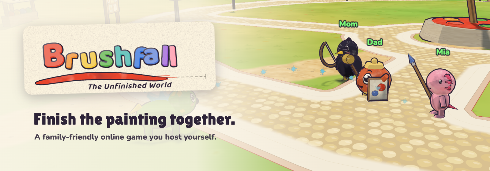
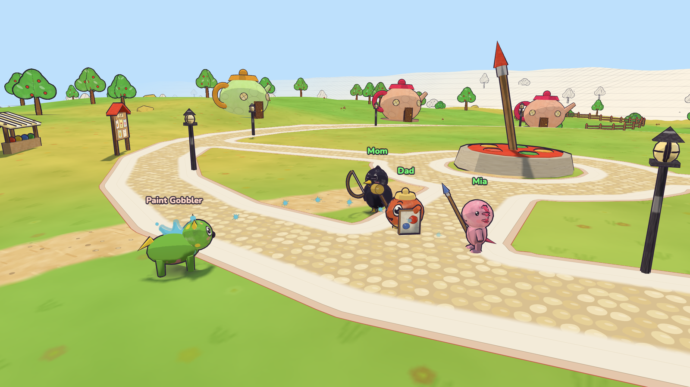
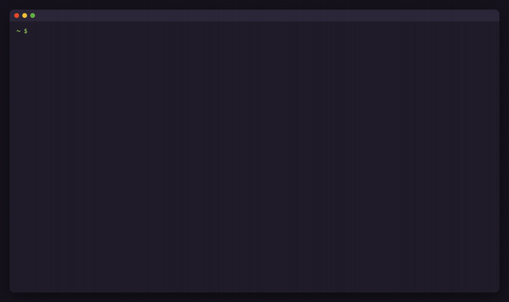
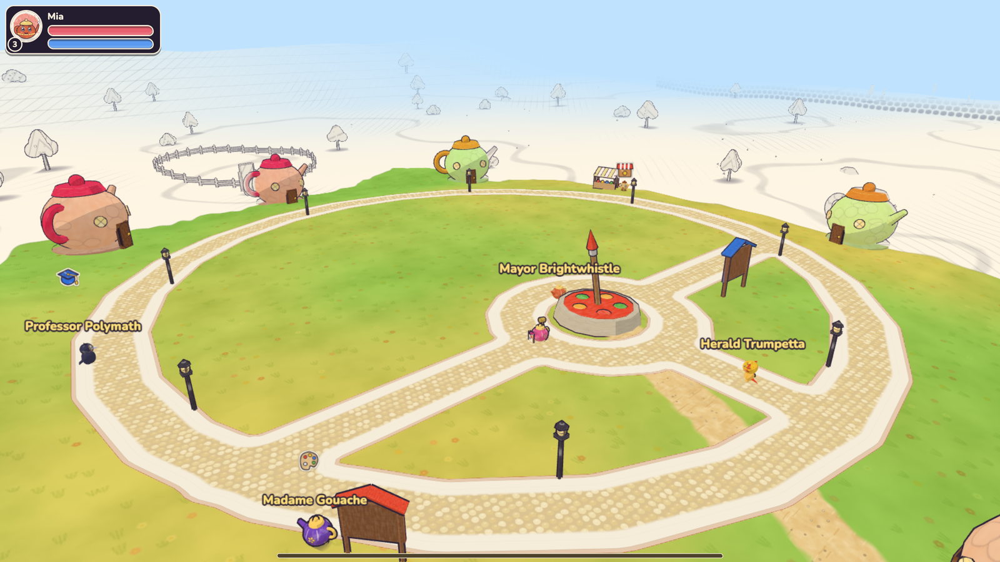
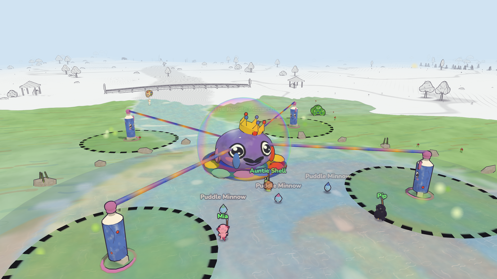
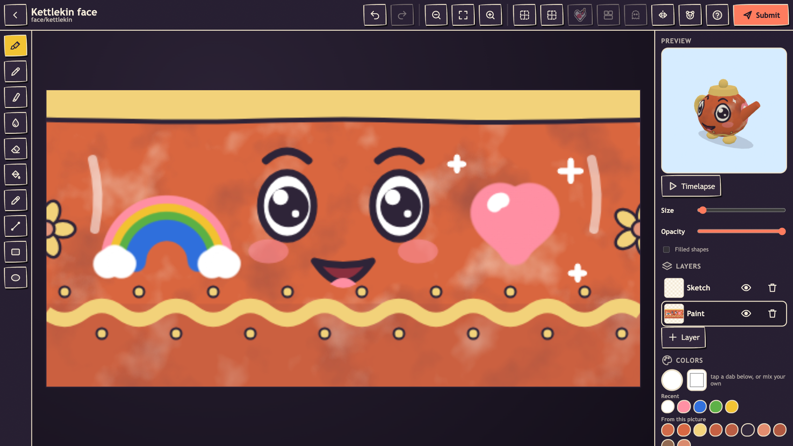
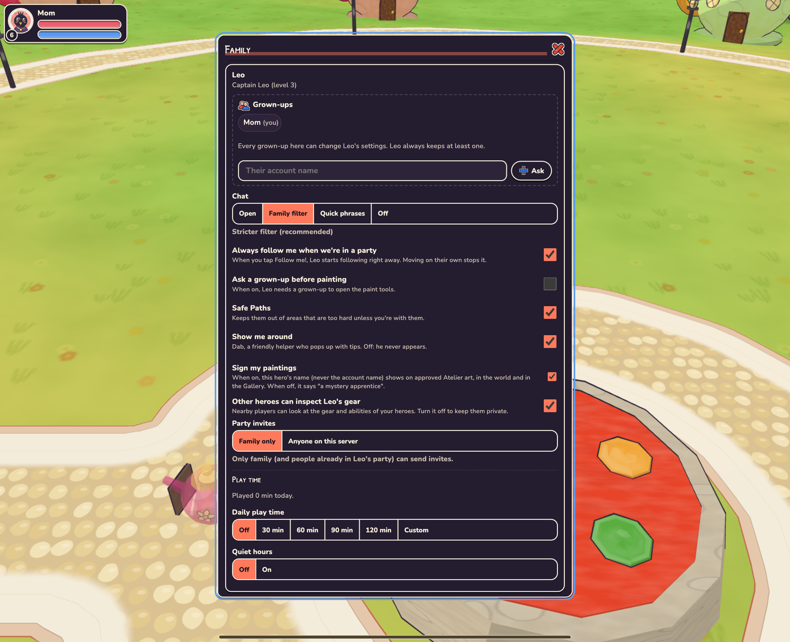
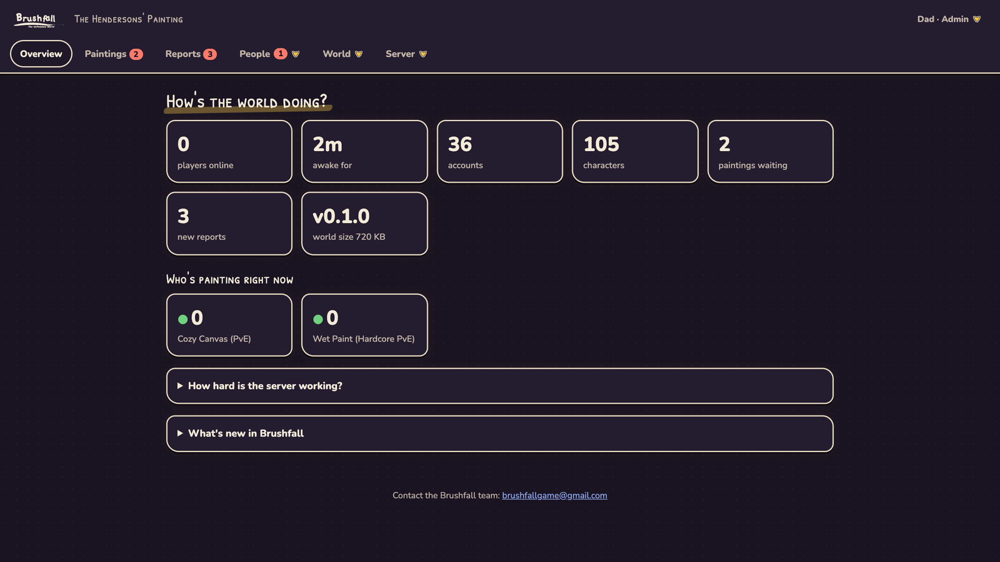
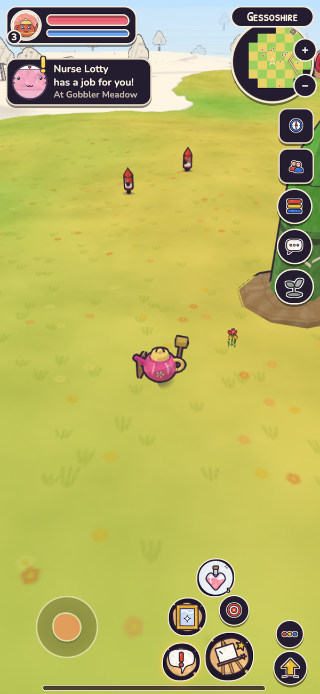

<p align="center">
  
</p>

<p align="center">
  <a href="PREVIEW.md"></a>
  <a href="https://github.com/Twelve47Studios/brushfall_release/wiki/Choosing-a-Setup"></a>
  <a href="https://github.com/Twelve47Studios/brushfall_release/wiki/Family-and-Kid-Safety"></a>
</p>

<h3 align="center">A family-friendly online role-playing game that you host yourself.</h3>

<p align="center">
  <a href="https://github.com/Twelve47Studios/brushfall_release/releases"><b>Download</b></a> ·
  <a href="https://github.com/Twelve47Studios/brushfall_release/wiki/Quick-Start"><b>Quick Start</b></a> ·
  <a href="https://github.com/Twelve47Studios/brushfall_release/wiki"><b>Guides</b></a> ·
  <a href="https://github.com/Twelve47Studios/brushfall_release/wiki/FAQ"><b>FAQ</b></a>
</p>

---

Brushfall runs on a computer in your home (or a small cloud server) and your family plays it in a web browser, on computers, tablets and phones. It's a co-op adventure: quests, dungeons, world bosses and crafting, in sessions short enough for a school night. The world starts half painted, and it fills in with color as you play.

- **For mixed ages.** Grown-ups get a full role-playing game. Young children can play as a Sprout hero, which follows a grown-up and joins in automatically.
- **Parent controls per child.** Chat level, daily play time, quiet hours, Safe Paths, and who may invite them to a party.
- **Private.** Accounts, chat and progress stay on your server. Only people you approve can join. Nothing is sent anywhere except a check for new versions.
- **No ads, no in-game purchases, no subscription.**

<p align="center">
  
</p>

## Host it

You need a computer that's often on: a desktop, laptop, NAS, Raspberry Pi 4/5 or small cloud server. Setup takes about 10 minutes.

<p align="center">
  
</p>

**With Docker** (recommended). Install [Docker](https://docs.docker.com/get-docker/), then run one line:

macOS, Linux, Raspberry Pi:

```sh
curl -fsSL https://raw.githubusercontent.com/Twelve47Studios/brushfall_release/main/setup.sh -o setup.sh && sh setup.sh
```

Windows (PowerShell):

```powershell
irm https://raw.githubusercontent.com/Twelve47Studios/brushfall_release/main/setup.ps1 -OutFile setup.ps1; powershell -ExecutionPolicy Bypass -File setup.ps1
```

The script checks Docker, creates a `brushfall` folder, picks a free port, starts the server and opens the Studio Desk in your browser. Enter the one-time setup code it prints, name your world, and create your admin account. There are no files to edit. You can read the script before running it: run the download part on its own, open the file, then run it.

**Without Docker.** Each [release](https://github.com/Twelve47Studios/brushfall_release/releases) has a download for Windows, Mac (Apple chip or Intel), Linux and Raspberry Pi, with everything it needs included. Unzip it, double-click `start.cmd` (Windows) or `start.command` (Mac), or run `./start.sh` (Linux), then open **http://localhost:8080/admin** to set it up.

**Family at home** join at the address the setup shows, or by scanning the QR code on the Studio Desk's **Hosting** tab. **Family in other homes:** run `sh setup.sh --share` (Windows: `setup.ps1 -Share`) for a free `https://` address through Tailscale Funnel, or see [Playing From Outside Home](https://github.com/Twelve47Studios/brushfall_release/wiki/Playing-From-Outside-Home) for Cloudflare Tunnel and other options.

Step-by-step guides: [Quick Start](https://github.com/Twelve47Studios/brushfall_release/wiki/Quick-Start) · [Windows](https://github.com/Twelve47Studios/brushfall_release/wiki/Windows) · [macOS](https://github.com/Twelve47Studios/brushfall_release/wiki/macOS) · [Linux](https://github.com/Twelve47Studios/brushfall_release/wiki/Linux) · [Raspberry Pi](https://github.com/Twelve47Studios/brushfall_release/wiki/Raspberry-Pi)

## What's in the game

### Play together



Seven playable races and six classes, two realms (**Cozy Canvas**, where a defeated hero respawns, and **Wet Paint**, where each hero has one life), parties, quests that guide you to the next step, crafting and personal loot, so nobody competes for drops. Mouse and keyboard, touch controls or a game controller.

### World bosses



Large encounters for the whole family, built around simple, readable mechanics: break the totems, stay out of the marked areas, heal each other. Everyone who takes part gets credit. Each time it's beaten, the world boss comes back a level stronger with better treasure.

### Paint the world



The **Atelier** is a paint tool built into the game: brushes, fill, layers, undo, a 3D preview and a timelapse of every stroke. Players can repaint creatures, buildings, signs and icons. A grown-up approves each painting before it appears in the world for everyone. Young children get a simpler version with big buttons and stickers.

### Parent controls



Link your children's accounts and choose, for each child: chat (filtered, family filter, preset phrases only, or off), daily play time and quiet hours, Safe Paths (keeps them out of areas that are too hard and shows the way to their next quest), party invites from family only, and whether they ask before painting. **Read to me** reads tips, quest steps and warnings aloud for children who can't read yet.

### The Studio Desk



The admin page for your server, at `/admin`: approve sign-ups, send invite links with a QR code, approve paintings, read reports, manage families, run backups and install updates. Updates can install automatically at night, with a backup first and an automatic rollback if a new version doesn't start.

<p align="center"></p>

## Requirements

| | |
|---|---|
| **Host** | Docker (Windows, macOS, Linux), or the download for your computer (nothing else to install) |
| **A family (up to about 20 players online)** | Raspberry Pi 4/5 (64-bit, 2 GB+ RAM), an old laptop or a NAS, with about 1 GB of free memory and 2 Mbit/s upload |
| **Bigger groups** | A small cloud server handles about 50 players. See [How big a computer do I need?](https://github.com/Twelve47Studios/brushfall_release/wiki/Choosing-a-Setup#how-big-a-computer-do-i-need) |
| **Players** | A current web browser on a computer, tablet or phone |

## Safety and privacy

- New players need your approval (or an invite link) before they can play. A new server can only be set up with the one-time code from your own computer.
- On a server reachable from the internet, admins and World Helpers must use 2-step sign-in for everything but hanging paintings.
- Chat is filtered for everyone, and can be limited per child.
- Reports about other players stay on your server. Bug reports go to the Brushfall team only if you forward them.
- Daily backups, kept on your server.

More in [Family and Kid Safety](https://github.com/Twelve47Studios/brushfall_release/wiki/Family-and-Kid-Safety) and [Keeping an internet server safe](https://github.com/Twelve47Studios/brushfall_release/wiki/Playing-From-Outside-Home#keeping-an-internet-server-safe).

## Status

Brushfall is in **early access**. It's ready for families to host and play, and it's still changing: expect new content, adjustments and the occasional bug. Updates keep your world, and your server makes a backup before each one. See [PREVIEW.md](PREVIEW.md).

**License:** free for personal, family and non-commercial hosting. See [LICENSE.txt](LICENSE.txt) and [License in Plain Words](https://github.com/Twelve47Studios/brushfall_release/wiki/License-in-Plain-Words).

## FAQ

<details>
<summary><b>Does it cost anything?</b></summary>
<br>
No. There are no ads, purchases or subscriptions. Donations are optional and don't unlock anything.
</details>

<details>
<summary><b>Do I need to be technical?</b></summary>
<br>
No. If you can paste one command into a terminal, you can host it. The <a href="https://github.com/Twelve47Studios/brushfall_release/wiki/Quick-Start">Quick Start</a> walks through every step.
</details>

<details>
<summary><b>What ages is it for?</b></summary>
<br>
Families: young children with a grown-up, older kids and adults on their own. Comparable to a PG rating: mild cartoon combat, nothing gory or frightening.
</details>

<details>
<summary><b>Can relatives in another house play?</b></summary>
<br>
Yes. See <a href="https://github.com/Twelve47Studios/brushfall_release/wiki/Playing-From-Outside-Home">Playing From Outside Home</a>. None of the options need router changes.
</details>

More in the [FAQ](https://github.com/Twelve47Studios/brushfall_release/wiki/FAQ) and [Troubleshooting](https://github.com/Twelve47Studios/brushfall_release/wiki/Troubleshooting).

## Help and contact

- **Questions and hosting help:** [open an issue](https://github.com/Twelve47Studios/brushfall_release/issues/new/choose)
- **Bugs:** use **Report a Problem** in the game and forward it from the Studio Desk, or [file a bug report](https://github.com/Twelve47Studios/brushfall_release/issues/new/choose)
- **Security issues:** report privately, see [SECURITY.md](SECURITY.md)
- **Email:** brushfallgame@gmail.com (don't send passwords or invite links)
- **Support the project:** [GitHub Sponsors](https://github.com/sponsors/Twelve47Studios) · [Other ways to help](https://github.com/Twelve47Studios/brushfall_release/wiki/Supporting-Brushfall)

Brushfall is made by Nicholas Schiavi.
